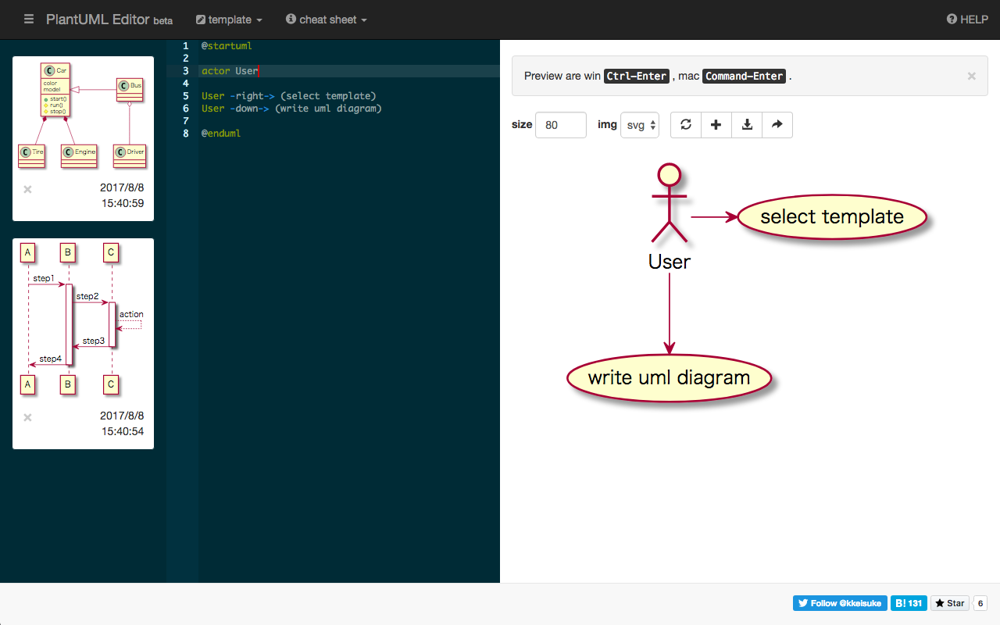

# PlantUML Editor for Atlassian Forge

> A Vue.js PlantUML editor running on Atlassian Forge for Confluence Cloud

 PlantUML diagram editor integrated into Confluence



## Overview

This is an Atlassian Forge application that brings PlantUML diagram editing capabilities to Confluence Cloud. Create, edit, and manage PlantUML diagrams directly within your Confluence pages.

### What is Atlassian Forge?

[Atlassian Forge](https://developer.atlassian.com/platform/forge/) is a cloud development platform that allows developers to build secure, performant apps for Atlassian products without managing infrastructure.

### Migration Status

This application has been migrated from a standalone web application to run on Atlassian Forge. For details on the migration process, see [MIGRATION.md](MIGRATION.md).

## Features

- **Multiple PlantUML templates** - Quick start with pre-built diagram templates
- **Cheat sheet** - Built-in reference for PlantUML syntax
- **Code snippets** - Reusable diagram components
- **Zoom & scroll** - Navigate large diagrams easily
- **Multiple formats** - Export as SVG or PNG
- **Confluence integration** - Save diagrams to Confluence pages
- **Local storage** - Browser-based diagram persistence
- **Markdown support** - Rich text editing capabilities
- **Download & print** - Export diagrams for offline use

### Forge-Specific Features

- **Confluence Macro** - Embed diagrams directly in pages
- **Global Editor** - Access full editor from any page
- **Content Byline** - Quick access from page bylines
- **Serverless Backend** - No infrastructure to manage
- **Secure by Default** - Built on Forge's security model

## Quick Start

### Prerequisites

- Node.js 18.x or later
- npm 8.x or later
- Forge CLI: `npm install -g @forge/cli`
- Atlassian account with a Confluence Cloud development site

### Installation

1. **Clone the repository**
   ```bash
   git clone <repository-url>
   cd powerplantuml
   ```

2. **Install Forge CLI** (if not already installed)
   ```bash
   npm install -g @forge/cli
   ```

3. **Authenticate with Forge**
   ```bash
   forge login
   ```

4. **Register the app**
   ```bash
   forge register
   ```

5. **Build the frontend**
   ```bash
   cd static/plantuml-editor
   npm install
   npm run build
   cd ../..
   ```

6. **Install backend dependencies**
   ```bash
   npm install
   ```

7. **Deploy the app**
   ```bash
   forge deploy
   ```

8. **Install to your Confluence site**
   ```bash
   forge install
   ```

## Development

### Local Development with Tunnel

For rapid development without deploying:

```bash
# Build the frontend
cd static/plantuml-editor
npm install
npm run build
cd ../..

# Start the tunnel
forge tunnel
```

The tunnel allows you to:
- Test changes without deploying
- See real-time logs
- Debug backend functions
- Hot-reload backend code

### Making Changes

**Frontend (Vue.js) Changes:**
```bash
cd static/plantuml-editor
# Make your changes to src/
npm run build
cd ../..
# Restart tunnel or redeploy
```

**Backend Changes:**
```bash
# Make your changes to src/index.js
# If using tunnel, changes auto-reload
# Otherwise, redeploy:
forge deploy
```

### Project Structure

```
powerplantuml/
├── manifest.yml                    # Forge app configuration
├── package.json                    # Forge backend dependencies
├── src/
│   └── index.js                   # Forge backend functions
├── static/
│   └── plantuml-editor/
│       ├── src/                   # Vue.js source code
│       │   ├── components/        # Vue components
│       │   ├── store/             # Vuex store
│       │   ├── lib/               # Utilities (including Forge bridge)
│       │   └── main.js           # Vue entry point
│       ├── public/                # Static assets
│       ├── build/                 # Built app (generated)
│       ├── package.json           # Vue.js + Forge bridge deps
│       └── vue.config.js          # Vue build configuration
├── MIGRATION.md                    # Migration documentation
├── DEPLOYMENT.md                   # Deployment guide
└── README.md                       # This file
```

### Building for Production

```bash
# Build the Vue frontend
npm run build

# Deploy to Forge
forge deploy --environment production
```

## Usage in Confluence

### As a Macro

1. Edit any Confluence page
2. Type `/plantuml` to insert the macro
3. The PlantUML editor opens
4. Create your diagram
5. Save and publish the page

### As a Global Page

1. Click the Apps menu (≡) in Confluence
2. Select "PlantUML Editor"
3. Use the full-page editor
4. Save diagrams to Confluence or export

### As a Content Byline Item

Look for the PlantUML icon in the content byline of Confluence pages for quick access.

## Configuration

### Manifest Configuration

The app is configured via `manifest.yml`:

- **Modules:** Defines where the app appears in Confluence
- **Resources:** Points to the built frontend assets
- **Functions:** Backend serverless functions
- **Permissions:** Required Confluence API access

See [manifest.yml](manifest.yml) for details.

### Environment Variables

Forge uses environment-specific variables. Set them with:

```bash
forge variables set KEY value --environment production
```

### External API Access

The app requires access to PlantUML servers. This is configured in `manifest.yml`:

```yaml
permissions:
  external:
    fetch:
      backend:
        - 'https://www.plantuml.com'
```

## Testing

### Unit Tests

```bash
cd static/plantuml-editor
npm run test:unit
```

### E2E Tests

```bash
cd static/plantuml-editor
npm run test:e2e
```

### Manual Testing

1. Deploy to development environment
2. Install on test Confluence site
3. Test all module locations
4. Verify diagram rendering
5. Test save/load functionality

## Deployment

For comprehensive deployment instructions, see [DEPLOYMENT.md](DEPLOYMENT.md).

### Quick Deploy

```bash
# Development
forge deploy

# Production
forge deploy --environment production
```

## Migration

This app has been migrated from a standalone application to Atlassian Forge. For details, see:

- **[MIGRATION.md](MIGRATION.md)** - Complete migration guide
- **Architecture changes** - How the app was restructured
- **Code changes** - What was modified and why
- **Testing strategy** - How to validate the migration

## Troubleshooting

### Common Issues

**App doesn't appear in Confluence**
- Verify installation: `forge install --list`
- Reinstall: `forge uninstall && forge install`

**Diagram rendering fails**
- Check logs: `forge logs --follow`
- Verify external fetch permissions in manifest.yml

**Build errors**
- Clear dependencies: `cd static/plantuml-editor && rm -rf node_modules && npm install`
- Rebuild: `npm run build`

For more troubleshooting, see [DEPLOYMENT.md](DEPLOYMENT.md#troubleshooting).

## Documentation

- **[MIGRATION.md](MIGRATION.md)** - Migration from standalone to Forge
- **[DEPLOYMENT.md](DEPLOYMENT.md)** - Deployment and operations guide
- **[Forge Documentation](https://developer.atlassian.com/platform/forge/)** - Official Forge docs
- **[PlantUML Documentation](https://plantuml.com/)** - PlantUML syntax reference

## Development Resources

- **Forge CLI Reference:** https://developer.atlassian.com/platform/forge/cli-reference/
- **Custom UI Guide:** https://developer.atlassian.com/platform/forge/custom-ui/
- **Confluence API:** https://developer.atlassian.com/cloud/confluence/rest/
- **Example Apps:** https://developer.atlassian.com/platform/forge/example-apps/

## Contributing

Contributions are welcome! Please:

1. Fork the repository
2. Create a feature branch
3. Make your changes
4. Test thoroughly
5. Submit a pull request

## License

See [LICENSE](LICENSE) file for details.

## Credits

- **Vue.js Framework:** https://vuejs.org/
- **PlantUML:** https://plantuml.com/
- **Atlassian Forge:** https://developer.atlassian.com/platform/forge/

Pen graphic by [freepik](http://www.flaticon.com/authors/freepik) from [Flaticon](http://www.flaticon.com/) is licensed under [CC BY 3.0](http://creativecommons.org/licenses/by/3.0/).

## Support

For issues and questions:

- **GitHub Issues:** Report bugs and request features
- **Atlassian Community:** https://community.developer.atlassian.com/
- **Forge Slack:** https://atlassian.design/get-started/slack/

## Roadmap

- [ ] Enhanced macro configuration UI
- [ ] Real-time collaboration
- [ ] Advanced export options
- [ ] Integration with Confluence templates
- [ ] Custom PlantUML server support
- [ ] Dark mode support

---

**Note:** This is an Atlassian Forge application. For the standalone version, see the legacy branches.
